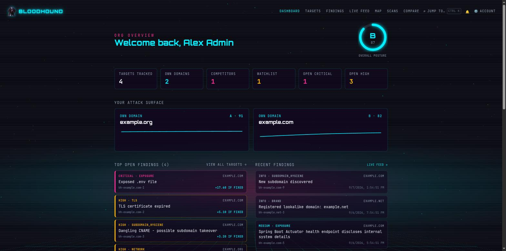
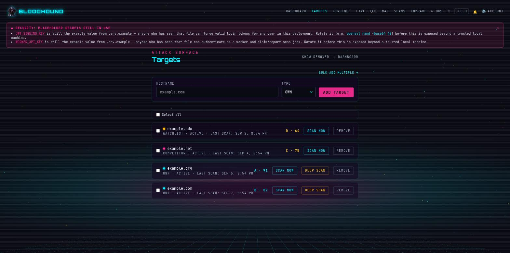
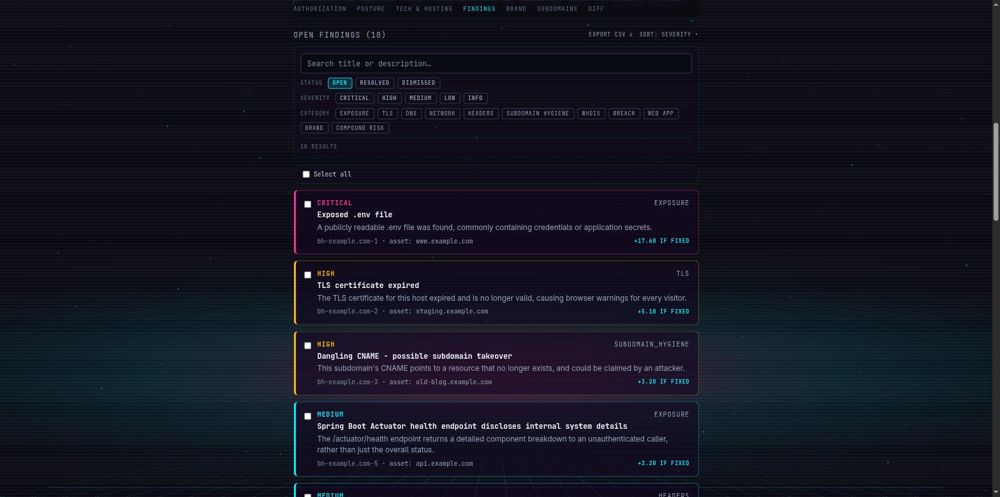
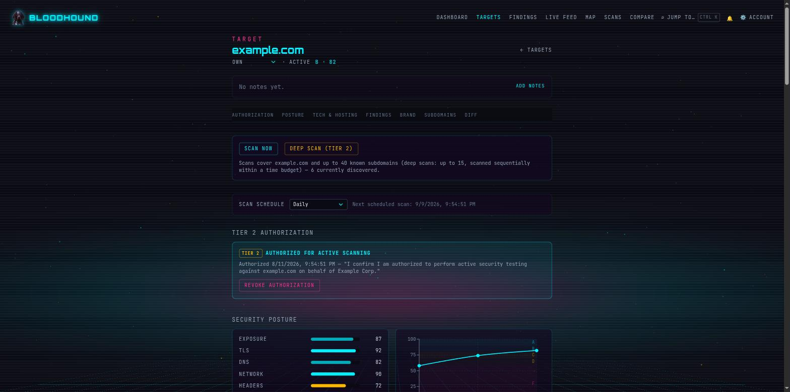
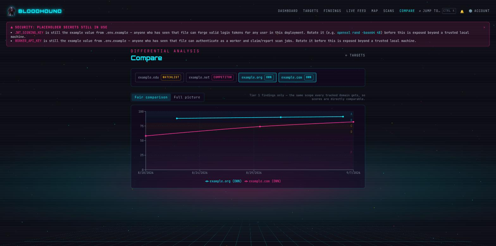
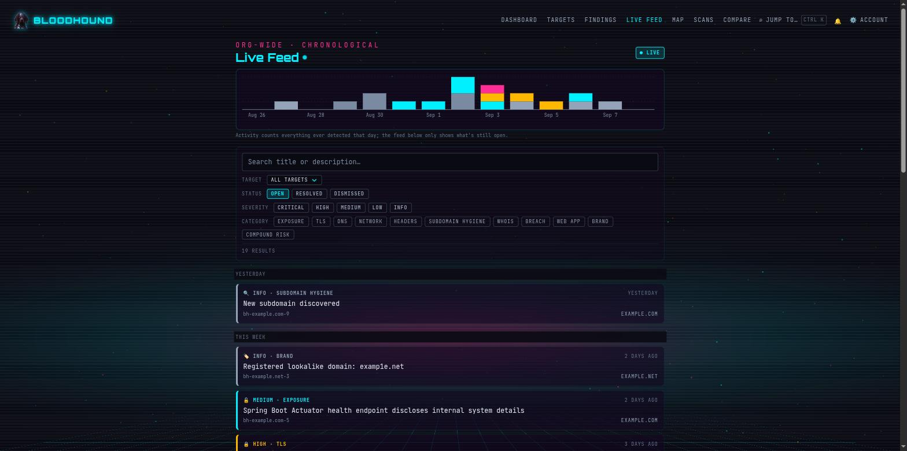
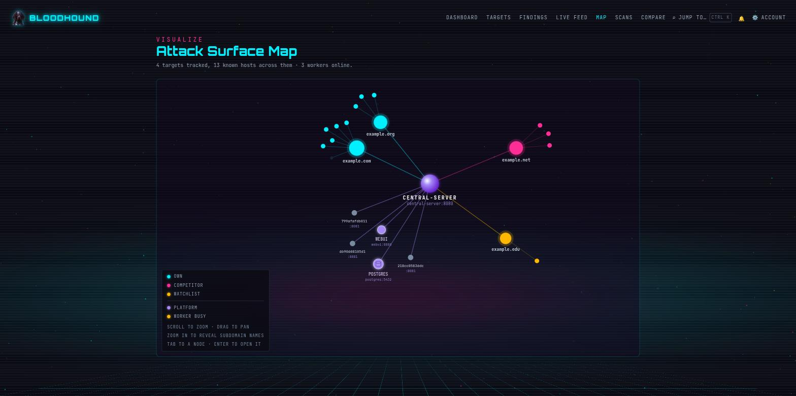
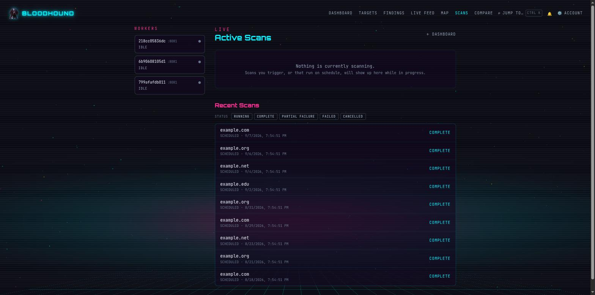

# Bloodhound

Bloodhound is an External Attack Surface Monitoring (ASM) platform. It
continuously discovers what an organization's internet-facing footprint
actually looks like, scores its security posture over time, and tracks that
score against competitor and watchlist domains — so "are we more or less
exposed than we were last month, and how do we compare to the market" has a
real, continuously-updated answer instead of a once-a-year pentest snapshot.



## The problem it solves

Most organizations don't have an accurate picture of their own external
attack surface. Subdomains get spun up and forgotten, TLS certificates
expire silently, DNS records drift out of best practice, admin consoles and
debug endpoints get exposed by accident, and none of it surfaces until
something goes wrong. Point-in-time security assessments catch a slice of
this once; they don't catch what changes the following week.

Bloodhound runs that discovery-and-assessment loop continuously and
automatically, and — because attack surface monitoring is explicitly about
watching *other* organizations' infrastructure too, not just your own — it
does so under a two-tier scanning model that keeps that legal:

- **Tier 1 (passive/OSINT)** runs against *any* tracked target, including
  competitor or watchlist domains you don't own, with no prior agreement
  needed — the same techniques a normal browser/DNS client already performs,
  plus a light, polite TCP-connect port sweep.
- **Tier 2 (active)** — full-port-range scanning and OWASP ZAP active
  scanning, which send genuine attack payloads — only ever runs against a
  target with an explicit, logged authorization attestation. There is no way
  to point Tier 2 at a target without that gate passing first.



## What it actually checks

- **Subdomain hygiene** — continuous discovery (certificate transparency +
  passive DNS sources), dangling-CNAME and dangling-NS-delegation
  subdomain-takeover detection (a subdomain independently delegated to a
  cloud DNS provider whose hosted zone has since been deprovisioned —
  claimable by anyone who notices, not just a single hostname's HTTP
  response like a CNAME takeover), stale/non-resolving subdomains.
- **DNS posture** — SPF/DMARC/DKIM, CAA, DNSSEC, MX/NS delegation health,
  zone-transfer exposure.
- **TLS/certificates** — expiry, weak protocols/ciphers, HSTS, and
  certificate-transparency monitoring that auto-triggers a full rescan when
  a new certificate for an unknown subdomain shows up.
- **HTTP headers & tech fingerprinting** — CSP/X-Frame-Options/etc.,
  cookie flags, passive technology detection.
- **Network exposure** — unexpected admin/database ports reachable from the
  internet, plaintext management protocols.
- **Misconfiguration/exposure checks** — Actuator endpoints, `.git`/`.env`
  leaks, exposed admin consoles, unauthenticated data stores, and more.
- **WHOIS/RDAP** — registrar/expiry monitoring, registrant changes.
- **Brand protection / typosquat monitoring** — lookalike-domain permutation
  generation and registration tracking, with a visual-similarity check on top:
  a screenshot of each newly-registered candidate is compared against a
  screenshot of your own real domain's homepage using perceptual hashing
  (dHash) — candidates that actually *look* like a convincing copy of your
  site score a high similarity percentage, a much stronger phishing signal
  than registration alone. Both screenshots are shown side by side in the
  brand-protection table so an analyst can eyeball a match directly rather
  than trusting the percentage blind.
- **CVE correlation** — fingerprinted software versions cross-referenced
  against NVD, OSV, and CISA's Known Exploited Vulnerabilities catalog.
- **Deep scan (Tier 2)** — full 1–65535 port discovery, best-effort service
  identification, cloud storage bucket brute-forcing (curated wordlists,
  resumable across runs), and OWASP ZAP active scanning (SQLi/XSS/path-
  traversal probes) for authorized targets.



Every finding rolls up into a 0–100 score per category and overall (A–F
grade), tracked over time, with a compare view for plotting your own domains
against competitors/watchlist targets on the same chart, and a run-over-run
findings diff (new / resolved / unchanged / severity-changed).





Findings across the whole org are also browsable two ways: a severity-ranked,
filterable list for triage, and a **Live Feed** — a purely chronological,
live-polling view (an activity histogram of when things spiked, day-by-day
drill-down, and a non-disruptive "N new findings" banner rather than
silently reflowing the list while you're reading) for "what's happening right
now" instead of "what's most urgent".



Every tracked target, its discovered subdomains, and the platform's own
components (central-server, Postgres, webui, live workers) also render as a
force-directed **Attack Surface Map** — a single visual answer to "what does
our footprint actually look like right now", with the currently-scanning
target highlighted live.



## Architecture

```
Browser --HTTPS--> webui (Spring Boot: serves the React SPA, login proxy)
                       |
                       v  REST/JSON (JWT)
                  central-server (API, auth, job orchestration,
                                  scoring/diff engine, sole DB access)
                       |  JDBC                    ^ REST (job claim/heartbeat/result)
                       v                           |
                   postgres                    worker x N (stateless, scoped API
                                                key only, claims jobs, runs scan
                                                modules, reports results back)
```

Only `central-server` ever touches Postgres. Workers and `webui` hold no
database credentials — workers authenticate with a scoped, revocable API
key and only claim/report jobs, which bounds the blast radius of a worker
that's actively scanning untrusted third-party infrastructure. The job
queue itself is Postgres-backed (`SELECT ... FOR UPDATE SKIP LOCKED`), so
workers scale horizontally with no separate message broker.



Enterprise identity is handled the same way any of this app's other
auth mechanisms are — a distinct, isolated path rather than a bolt-on:
SAML SSO (any IdP, per-org configuration, admin-managed) for user login,
and SCIM 2.0 for automated user provisioning/deprovisioning from an
identity provider. Every admin action across the app — rule changes, user
role/status changes, API key and SSO/SCIM config lifecycle — is written to
a searchable, exportable audit log.

## AI agent access (MCP)

Bloodhound exposes a read-only [Model Context Protocol](https://modelcontextprotocol.io/)
server so an AI agent (Claude, or any other MCP-capable client) can query an
org's targets, findings, subdomains, and scan runs directly — the same
data the read-only external API exposes, reachable by an agent instead of
a script. Authentication is OAuth2 with Dynamic Client Registration
(RFC 7591): a client self-registers and a human approves it via a normal
consent screen, no admin has to hand-provision a client ID beforehand.
Two independent kill switches (org-wide, and per-user) let an admin cut
off MCP access instantly, and the admin MCP page lists every currently-
connected client with a one-click revoke.

## Deploying it

**Prerequisites:** Docker and Docker Compose.

```bash
git clone <this repo>
cd bloodhound
cp .env.example .env
```

Edit `.env` and generate real values for every `<generate-with-...>`
placeholder (the file tells you the exact command for each, e.g.
`openssl rand -base64 48`). Central-server refuses to start if
`JWT_SIGNING_KEY` is missing or too short, and warns loudly — on startup,
and as a banner in the UI itself for any admin who logs in — if any secret
is still an example placeholder. Don't ignore that warning in anything
reachable beyond your own machine.

```bash
docker compose up -d --build
```

This brings up Postgres, `central-server`, three `worker` replicas, `webui`, and the
Tier 2 sidecars (`zap`, `screenshotter`). Postgres's schema is created
automatically on first boot (Flyway), along with a bootstrap organization
and admin user from the `BOOTSTRAP_*` variables in `.env`. The dev/test
fixtures below (`juice-shop`, `saml-test-idp`) are **not** included by this
command — see "Optional dev/test fixtures".

Once everything's healthy:

- **App**: http://localhost:8090 — log in with `BOOTSTRAP_ADMIN_EMAIL` /
  `BOOTSTRAP_ADMIN_PASSWORD` from your `.env`.
- **API** (central-server, mainly for the worker fleet and direct API use):
  http://localhost:8080

### Scaling workers

```bash
docker compose up -d --scale worker=5
```

Workers are stateless and claim jobs via `FOR UPDATE SKIP LOCKED`, so any
number can run concurrently with no coordination needed beyond Postgres
itself.

### Trying Tier 2 (active scanning) safely

Tier 2 needs a target with `authorization_status = AUTHORIZED`, set via an
explicit attestation in the UI — there's no bare toggle. To try it out
without pointing active scanning at anyone else's infrastructure, the
compose file includes a deliberately-vulnerable practice target
(`juice-shop`, fronted by `juiceshop-proxy` on `juiceshop.local` so it
behaves like a normal domain to every scan module) — bring it up with the
`dev-fixtures` profile (see below), register `juiceshop.local` as a target,
authorize it, and run a deep scan against it.

### Optional dev/test fixtures

`juice-shop`/`juiceshop-proxy` (the Tier 2 practice target above) and
`saml-test-idp` (a practice SAML identity provider for exercising SSO
end-to-end) are for local development and evaluation only — neither should
ever be part of a production deployment, so they're gated behind Compose's
`dev-fixtures` profile and a plain `docker compose up` no longer starts
them (a security review found the previous quickstart brought them up by
default with nothing actually enforcing that they got stripped before
deploying anywhere beyond a trusted machine). Opt in explicitly:

```bash
docker compose --profile dev-fixtures up -d --build
# or: COMPOSE_PROFILES=dev-fixtures docker compose up -d --build
```

`central-server`'s port (8080) is still published to the host by default
for direct API/swagger access and local debugging — a real browser only
ever needs webui's port (8090), which proxies every API/SCIM/swagger route
to central-server anyway. Drop that `ports:` mapping in your own
override/prod compose file if you want central-server host-unreachable
entirely.

## License

Apache License 2.0 — see [LICENSE](LICENSE). Third-party software
attributions are in [NOTICE](NOTICE); external network services the
running application calls out to are in
[THIRD_PARTY_SERVICES.md](THIRD_PARTY_SERVICES.md).
